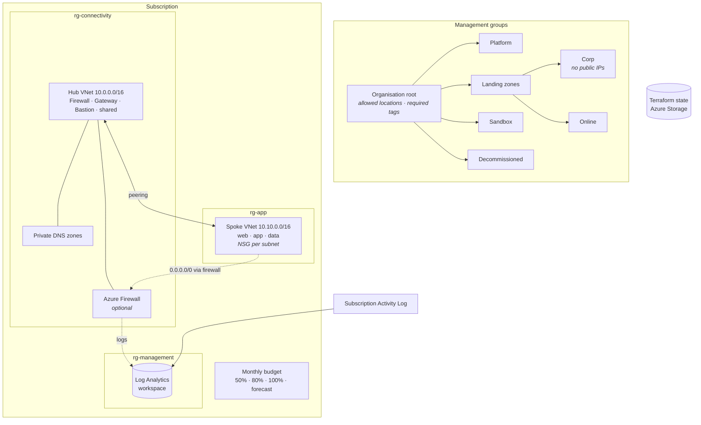

# Building an Azure Landing Zone with Terraform

*A practical guide, with working code, to the foundations every company needs before it puts workloads in Azure.*

[](https://github.com/diogosmoreira84/azure-enterprise-landing-zone/actions/workflows/terraform-check.yml)


---

## Contents

1. [Why landing zones exist](#1-why-landing-zones-exist)
2. [The eight design areas](#2-the-eight-design-areas)
3. [Architecture of this repository](#3-architecture-of-this-repository)
4. [Step 1: Organise resources with management groups](#step-1-organise-resources-with-management-groups)
5. [Step 2: Set guardrails with Azure Policy](#step-2-set-guardrails-with-azure-policy)
6. [Step 3: Centralise logging](#step-3-centralise-logging)
7. [Step 4: Design the network](#step-4-design-the-network)
8. [Step 5: Keep costs under control](#step-5-keep-costs-under-control)
9. [Step 6: Automate the platform](#step-6-automate-the-platform)
10. [Deploy it yourself](#deploy-it-yourself)
11. [From reference to production](#from-reference-to-production)
12. [Further reading](#further-reading)

---

## 1. Why landing zones exist

The first workloads in a new cloud account are usually deployed by hand. It works, until it doesn't. A year later the same company typically has:

- resources spread across regions nobody approved,
- no way of knowing who owns a resource group or which cost centre pays for it,
- virtual networks with overlapping address ranges that can never be connected,
- databases with public IP addresses "just for testing",
- and a monthly bill that grows faster than the business.

Fixing this after the fact is slow and risky, because every change touches something that is already in production.

A **landing zone** solves the problem upfront. It is the pre-built environment that workloads "land" in: the hierarchy, rules, networking, logging and cost controls are already in place, so every new team starts secure, compliant and observable by default. Teams get speed; the platform team keeps control.

This repository is a compact, working reference of that idea, written in Terraform and validated in CI. It is small enough to read in an afternoon and cheap enough to run in a personal subscription.

## 2. The eight design areas

Microsoft's [Cloud Adoption Framework](https://learn.microsoft.com/azure/cloud-adoption-framework/ready/landing-zone/) describes a landing zone through eight design areas. This is how this repository maps to them:

| Design area | Covered here | How |
|---|:---:|---|
| Billing and Microsoft Entra tenant | | Out of scope: decided once per organisation, outside Terraform |
| Identity and access management | | See [From reference to production](#from-reference-to-production) |
| Resource organisation | ✅ | Management group hierarchy, subscription placement, naming and tagging |
| Network topology and connectivity | ✅ | Hub and spoke, NSGs, peering, optional firewall, private DNS |
| Security | ✅ | Deny-by-default NSGs, no public IPs in Corp, optional central egress firewall |
| Management | ✅ | Central Log Analytics workspace and Activity Log export |
| Governance | ✅ | Azure Policy guardrails and budgets |
| Platform automation and DevOps | ✅ | Modular Terraform, remote state, CI with lint and security scanning |

## 3. Architecture of this repository



The code is organised by platform responsibility. The root module only composes the modules; each module is something a platform team would own.

```
.
├── main.tf                    composition of all modules
├── variables.tf               inputs with sensible defaults
├── outputs.tf
├── providers.tf               provider and remote state backend
├── terraform.tfvars.example   copy to terraform.tfvars
├── bootstrap/                 storage account for remote state (run once)
├── modules/
│   ├── management-groups/     hierarchy and subscription placement
│   ├── policy/                guardrail assignments
│   ├── logging/               Log Analytics and Activity Log export
│   ├── hub-network/           hub VNet, reserved subnets, firewall, private DNS
│   ├── spoke-network/         spoke VNet, subnets, NSGs, peering, routes
│   └── budget/                subscription budget and alerts
└── .github/workflows/         CI: fmt, validate, TFLint, Checkov
```

---

## Step 1: Organise resources with management groups

**The idea.** Management groups are folders above subscriptions. Anything assigned to a management group (policies, role assignments) is inherited by every subscription below it. Designing the hierarchy well means you configure governance once, high in the tree, instead of in every subscription.

**The design used here** follows the Cloud Adoption Framework, kept deliberately shallow:

| Management group | Purpose |
|---|---|
| **Platform** | Shared services owned by the platform team: management, connectivity, identity |
| **Landing zones / Corp** | Internal workloads. No direct internet exposure |
| **Landing zones / Online** | Internet-facing workloads, with their own, stricter, edge controls |
| **Sandbox** | Experiments with loose rules, isolated from production networks |
| **Decommissioned** | Subscriptions being retired, kept until they are safely cancelled |

**Lessons that matter:**

- **Organise by the rules a workload needs, not by the org chart.** Departments change every reorganisation; "internal" vs "internet-facing" does not.
- **Keep it shallow.** Three or four levels are enough for most companies. Deep trees make inheritance hard to reason about.
- **Have a place for the exceptions.** Sandbox and Decommissioned stop people from bending the rules of the production groups.

```hcl
resource "azurerm_management_group" "landing_zones" {
  for_each = {
    corp   = "Corp"
    online = "Online"
  }

  name                       = "${var.prefix}-${each.key}"
  display_name               = each.value
  parent_management_group_id = azurerm_management_group.level1["landingzones"].id
}
```

Code: [`modules/management-groups`](modules/management-groups)

## Step 2: Set guardrails with Azure Policy

**The idea.** Azure Policy evaluates every resource against rules and can deny, audit or fix what doesn't comply. Policies are the difference between a guideline that people forget and a rule the platform enforces.

**Guardrails applied here:**

| Policy | Scope | Why |
|---|---|---|
| Allowed locations | Organisation root | Data residency and a predictable footprint |
| Require tags on resource groups (`owner`, `businessUnit`, `costCenter`) | Organisation root | Every cost and every incident has an owner |
| Network interfaces should not have public IPs | Corp | Internal workloads stay internal |

**Lessons that matter:**

- **Assign high, exempt low.** Put guardrails on the highest management group where they make sense and use exemptions for the few justified exceptions.
- **Prefer built-in policies.** They are maintained by Microsoft and well understood by auditors. This repository looks them up by display name instead of hard-coding GUIDs, which keeps the code readable.
- **In an existing environment, start with audit.** Switching straight to deny in a brownfield subscription breaks deployments. Audit first, fix, then enforce.

```hcl
data "azurerm_policy_definition_built_in" "allowed_locations" {
  display_name = "Allowed locations"
}

resource "azurerm_management_group_policy_assignment" "allowed_locations" {
  name                 = "allowed-locations"
  management_group_id  = var.root_management_group_id
  policy_definition_id = data.azurerm_policy_definition_built_in.allowed_locations.id

  parameters = jsonencode({
    listOfAllowedLocations = { value = var.allowed_locations }
  })
}
```

Code: [`modules/policy`](modules/policy)

## Step 3: Centralise logging

**The idea.** When something breaks, or when an auditor asks who changed a firewall rule, the answer must be in one place. A central Log Analytics workspace is that place.

**What is collected here:**

- the **subscription Activity Log** (administrative operations, security and policy events, service health),
- **Azure Firewall logs**, when the firewall is enabled.

**Lessons that matter:**

- **Collect the Activity Log from day one.** It is the audit trail of the control plane and it is lost after 90 days if you don't export it.
- **Set retention deliberately.** Log volume is the biggest driver of monitoring cost. 30 days is fine for a lab; regulated companies often need a year or more, usually in cheaper archive storage.

Code: [`modules/logging`](modules/logging)

## Step 4: Design the network

**The idea.** In a **hub-and-spoke** topology, shared network services live in a central hub VNet and every workload gets its own spoke VNet, peered to the hub. Spokes are isolated from each other by default, and everything that crosses a boundary goes through the hub, where it can be inspected.

**What the hub contains:**

| Subnet | Purpose |
|---|---|
| `AzureFirewallSubnet` | Azure Firewall, for central egress filtering (optional) |
| `GatewaySubnet` | VPN or ExpressRoute gateway to on-premises (reserved) |
| `AzureBastionSubnet` | Azure Bastion, for admin access without public IPs (reserved) |
| `snet-shared` | Shared services such as DNS forwarders or build agents |

**What every spoke gets:** its own resource group, VNet and subnets; one NSG per subnet that denies inbound internet traffic; peering in both directions with the hub; and, when the firewall is enabled, a route table that sends all outbound traffic (`0.0.0.0/0`) through it.

**Private DNS** zones for Private Endpoints (for example `privatelink.blob.core.windows.net`) are hosted in the hub and linked to every spoke, so services are resolved to private IPs the same way everywhere.

**Lessons that matter:**

- **Plan the address space once, for the whole company.** Overlapping ranges are the one networking mistake that cannot be fixed later without rebuilding. Here, hub subnets are derived from a single range with `cidrsubnet()`, so there is no manual subnet maths.
- **Reserve the special subnets early.** Firewall, Gateway and Bastion require exact names and minimum sizes. Carving them out on day one avoids re-addressing the hub later.
- **Peering is not transitive.** Spoke A cannot reach spoke B through the hub unless traffic is routed through a network appliance, which is exactly what the firewall and route tables do.
- **Make expensive components optional.** Azure Firewall has a significant fixed monthly cost. It is one variable away, but off by default.
- **New workloads are data, not code.** Adding a spoke means adding an entry to a map:

```hcl
spokes = {
  app = {
    address_space = "10.10.0.0/16"
    subnets       = { web = "10.10.1.0/24", app = "10.10.2.0/24", data = "10.10.3.0/24" }
  }
  payments = {
    address_space = "10.20.0.0/16"
    subnets       = { api = "10.20.1.0/24", db = "10.20.2.0/24" }
  }
}
```

Code: [`modules/hub-network`](modules/hub-network), [`modules/spoke-network`](modules/spoke-network)

## Step 5: Keep costs under control

**The idea.** Cost is a design area like any other. The cheapest moment to control it is before the resources exist.

**What is in place here:**

- **Standard tags** on every resource (`owner`, `businessUnit`, `costCenter`, `environment`, `managedBy`), enforced by policy on resource groups, so every euro can be traced to a team.
- A **monthly budget** with alerts at 50%, 80% and 100% of actual spend, plus a **forecast** alert that warns before the month ends.
- **Opt-in for expensive services**, as with the firewall above.

**Lessons that matter:**

- **Tags only work if they are enforced.** Optional tags are missing within weeks.
- **Forecast alerts are the useful ones.** An alert at 100% of actual spend tells you about money already gone.

Code: [`modules/budget`](modules/budget)

## Step 6: Automate the platform

**The idea.** A landing zone is a product that the platform team runs and evolves. It needs the same engineering discipline as any other product.

**What is in place here:**

- **Remote state with locking.** [`bootstrap/`](bootstrap) creates a hardened Azure Storage account for the Terraform state: TLS 1.2, no public blobs, **shared keys disabled** (access through Microsoft Entra ID and RBAC only), versioning and soft delete so a bad apply can be recovered.
- **Modules per responsibility**, each with its own inputs, outputs and provider constraints.
- **Validation on every input that can be wrong**: prefix format, CIDR ranges, budget amount, management group names.
- **CI on every pull request** ([`.github/workflows/terraform-check.yml`](.github/workflows/terraform-check.yml)):
  - `terraform fmt` and `terraform validate`, for the main code and the bootstrap,
  - [TFLint](https://github.com/terraform-linters/tflint) with the recommended rule set,
  - [Checkov](https://www.checkov.io/) security scanning. Every check that is skipped is skipped on purpose, with the reason written next to the resource.

---

## Deploy it yourself

**Requirements:** Terraform 1.6 or later, the Azure CLI and an Azure subscription. Creating management groups needs permissions at tenant root; set `create_management_groups = false` if you don't have them.

```bash
az login

# 1. Create the remote state storage (once)
cd bootstrap
terraform init
terraform apply -var="subscription_id=<your-subscription-id>"
terraform output backend_config
cd ..

# 2. Point providers.tf at the state storage, using the output above

# 3. Deploy the landing zone
cp terraform.tfvars.example terraform.tfvars   # fill in your values
terraform init
terraform plan
terraform apply
```

With the default settings (no firewall, no private DNS zones, 30 days of log retention) the running cost is very low, and the budget alerts tell you if that changes. Enabling Azure Firewall changes the cost profile completely; check the [Azure pricing calculator](https://azure.microsoft.com/pricing/calculator/) first.

## From reference to production

This repository shows the patterns. A production landing zone for a real company adds:

- **Identity and access:** Microsoft Entra ID groups mapped to roles at management group level, Privileged Identity Management for just-in-time admin access, and break-glass accounts.
- **Subscription vending:** a self-service process that creates a new subscription per workload, places it in the right management group and connects it to the hub.
- **Separate platform subscriptions** for management, connectivity and identity.
- **Security posture:** Microsoft Defender for Cloud, and diagnostic settings enforced by policy for every resource type.
- **Hybrid connectivity:** VPN or ExpressRoute gateways in the hub, and DNS forwarding to on-premises.
- **Microsoft's accelerators:** for large estates, the [Azure Landing Zones Terraform modules](https://learn.microsoft.com/azure/architecture/landing-zones/terraform/landing-zone-terraform) and Azure Verified Modules give a fully supported baseline to build on.

## Further reading

- [What is an Azure landing zone?](https://learn.microsoft.com/azure/cloud-adoption-framework/ready/landing-zone/) (Cloud Adoption Framework)
- [Azure landing zone design areas](https://learn.microsoft.com/azure/cloud-adoption-framework/ready/landing-zone/design-areas)
- [Azure landing zone design principles](https://learn.microsoft.com/azure/cloud-adoption-framework/ready/landing-zone/design-principles)
- [Azure landing zones Terraform module](https://learn.microsoft.com/azure/architecture/landing-zones/terraform/landing-zone-terraform)

---

*Released under the [MIT License](LICENSE).*
